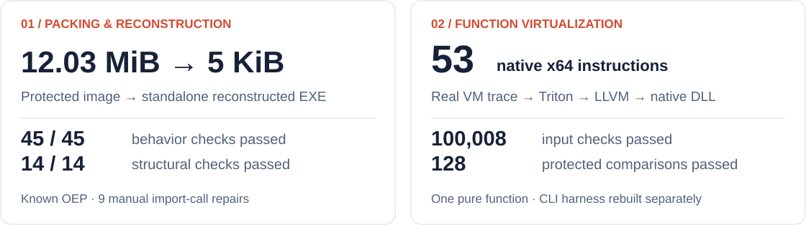
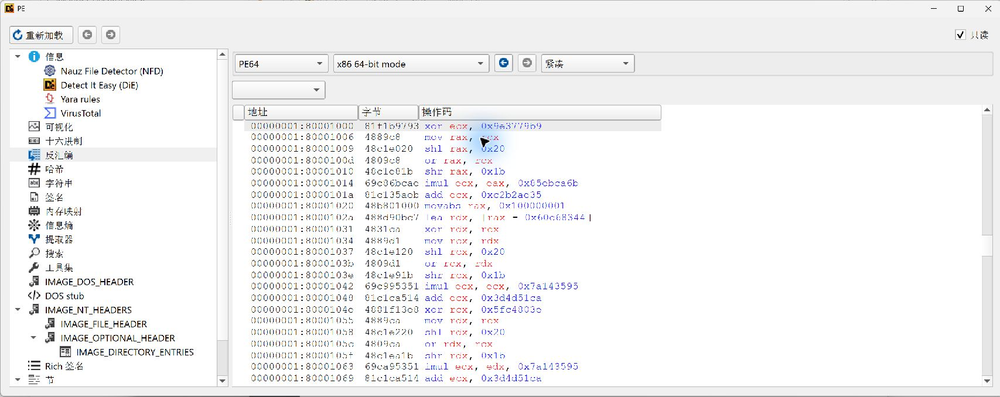
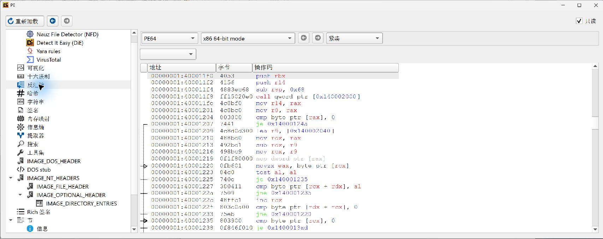
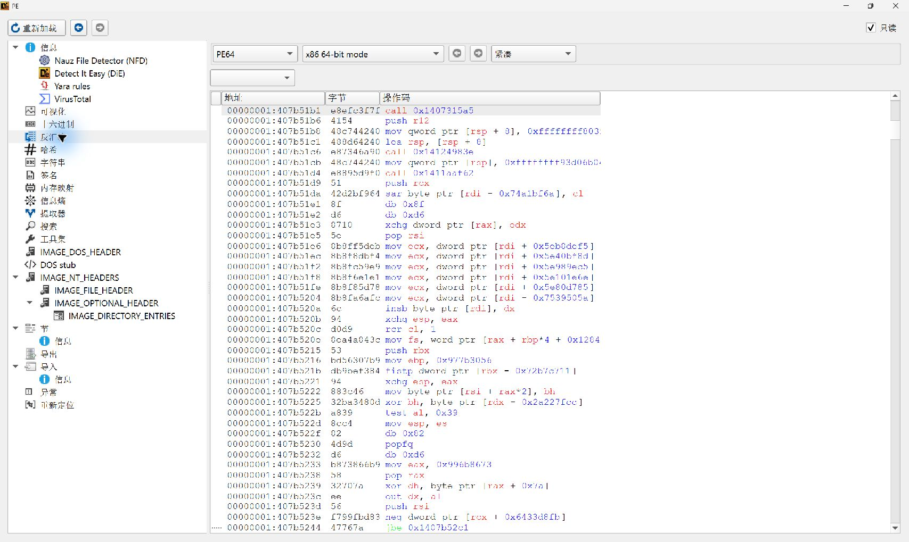
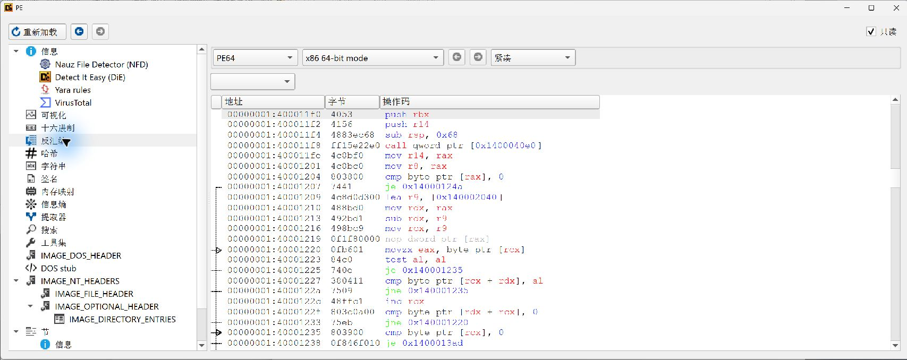
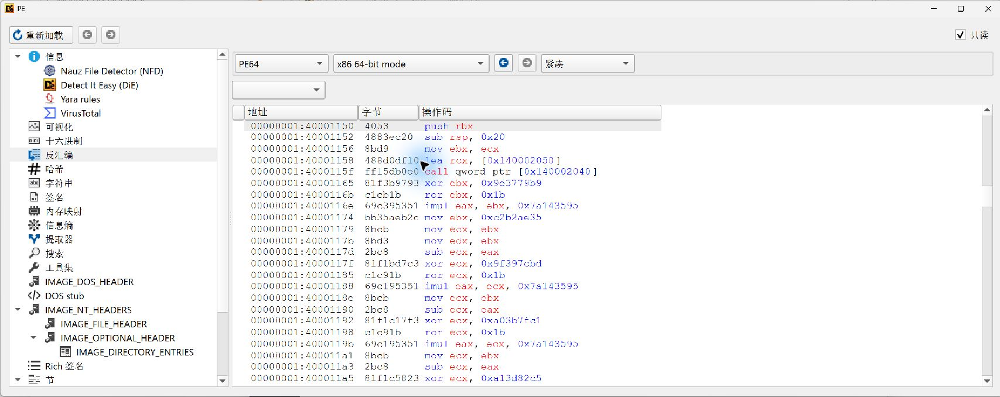
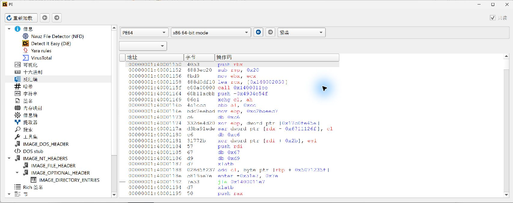

<div align="center">

<picture>
  <source media="(max-width: 600px) and (prefers-color-scheme: dark)" srcset="docs/assets/readme-hero-dark-mobile.svg">
  <source media="(max-width: 600px)" srcset="docs/assets/readme-hero-mobile.svg">
  <source media="(prefers-color-scheme: dark)" srcset="docs/assets/readme-hero-dark.svg">
  
</picture>

# Reverse Engineering & Unpacking

**Une méthode de rétro-ingénierie pour votre agent IA, de l’analyse initiale à la reconstruction vérifiée.**

Windows / .NET · Android / DEX · Native / ELF

[](pyproject.toml)
[](CHANGELOG.md)
[](LICENSE)

[**Cas mesurés**](#measured-cases) · [**Démarrage rapide**](#quick-start) · [CI et téléchargements](https://github.com/rancy777/reu/actions/workflows/ci.yml?query=branch%3Amain) · [Documentation](#documentation)

[English](README.md) · [简体中文](README.zh-CN.md) · [日本語](README.ja.md) · [한국어](README.ko.md) · [Español](README.es.md) · **Français** · [Deutsch](README.de.md) · [Português (Brasil)](README.pt-BR.md) · [Русский](README.ru.md)

</div>

REU associe **Agent Skill + CLI Python** pour examiner des fichiers, planifier des expériences, connecter des outils d’analyse existants et conserver des résultats vérifiables. Vous fournissez l’échantillon et l’environnement ; REU fournit la démarche, le routage et les traces de l’investigation.

<a id="measured-cases"></a>

## Cas mesurés

**VMProtect 3.8.4 · Windows x64 · 2026-10-17**

<picture>
  <source media="(max-width: 600px) and (prefers-color-scheme: dark)" srcset="docs/assets/readme-cases-dark-mobile.svg">
  <source media="(max-width: 600px)" srcset="docs/assets/readme-cases-mobile.svg">
  <source media="(prefers-color-scheme: dark)" srcset="docs/assets/readme-cases-dark.svg">
  
</picture>

- **[Empaquetage → reconstruction d’un EXE autonome](docs/cases/vmprotect-3.8.4-x64.md)** — Un dump à l’exécution et la réparation des imports ont produit un EXE autonome. **45/45 contrôles de comportement et 14/14 contrôles de structure réussis**. [Sources et validation](examples/vmprotect-3.8.4-x64).
- **[Virtualisation de fonction → sémantique native](docs/cases/vmprotect-3.8.4-virtualized-x64.md)** — Trace réelle du débogueur → expression récupérée → fonction native compilée. **53 instructions, 100 008 contrôles d’entrée et 128 comparaisons différentielles avec le programme protégé**. [Sources et validation](examples/vmprotect-3.8.4-virtualized-x64).

Deux échantillons créés pour ces expériences, avec des réglages de protection différents. Le cas d’empaquetage utilise un OEP connu et des réparations manuelles des imports. La récupération concerne **une seule fonction pure**, avec un harnais de test CLI recompilé séparément ; l’équivalence SMT sur tout le domaine reste non démontrée. Il ne s’agit pas d’une restauration à l’identique des octets de la fonction ou de l’EXE complet.

[](docs/assets/vmp-3.8.4-virtualized-x64/07-recovered-native-function.jpg)

Captures réelles de désassemblage statique. Cliquez sur l’image pour l’afficher en taille réelle. Les rapports conservent réglages, essais infructueux, empreintes et limites.

<details>
<summary>Comparaison interne : avant protection → protégé → reconstruit</summary>

**Avant protection : point d’entrée d’origine**



**Protégé : point d’entrée du protecteur**



**Reconstruit : point d’entrée d’origine et imports réparés**



</details>

<details>
<summary>Comparaison de fonction : calcul d’origine → entrée VM → instructions natives récupérées</summary>

**Avant virtualisation : calcul marqué avec le SDK**



**Après virtualisation : entrée dans la machine virtuelle VMP**



**Après récupération : instructions natives compilées à partir de la sémantique récupérée**


</details>

<a id="quick-start"></a>

## Démarrage rapide

Il faut **Python 3.11+** et un accès à ce dépôt privé. Lancez les commandes à la racine du projet.

```bash
git clone https://github.com/rancy777/reu.git
cd reu
python -m pip install -e .
re-skill route --input runtime/examples/triage.sample.json
```

Aucun serveur MCP ni exécution du fichier cible n’est nécessaire. Les métadonnées synthétiques fournies déclarent un chargement DEX dynamique, d’où le choix de ces workflows. `Unknown` reste explicitement inconnu.

<details>
<summary>Extrait de la sortie réelle</summary>

```json
{
  "platform": "android",
  "architecture": "arm64",
  "workflows": [
    "android-triage",
    "android-dex",
    "android-dynamic-loading"
  ],
  "protection_status": "Unknown"
}
```

</details>

Pour une analyse initiale d’un fichier que vous êtes autorisé à examiner :

```bash
re-skill triage --file ./sample.exe --route
```

Enregistre le SHA-256, examine les structures prises en charge et propose un workflow **sans exécuter la cible**.

### Utiliser avec votre agent

Installez le Skill local complet. L’installation s’arrête si le dossier de destination existe déjà.

```bash
python scripts/install_skill.py
```

```text
$reverse-engineering-unpacking
Analyse ./sample.exe, que je suis autorisé à examiner.
Commence en lecture seule : SHA-256, architecture et indices de protection.
Propose la prochaine expérience, explique ce qu’elle vérifie et conserve les preuves. Distingue faits, hypothèses et inconnues.
```

La destination par défaut est `~/.agents/skills/reverse-engineering-unpacking`. Installez la CLI séparément et indiquez à l’agent le chemin absolu de son exécutable si vous travaillez ailleurs.

### Recompiler la démonstration native

Requiert **Windows x64, Python 3.11 x64, les outils de compilation C++ x64 de Visual Studio et un Windows SDK**. Depuis la racine du projet :

```powershell
powershell -NoProfile -File .\examples\vmprotect-3.8.4-virtualized-x64\source\rebuild_demo.ps1
```

Télécharge une version fixée de llvmlite dans un nouvel environnement, compile l’IR récupéré publié, puis lie la DLL et le harnais CLI. Effectue **45 contrôles de comportement** sur un EXE renommé et placé seul. Aucun VMProtect ni SDK propriétaire n’est requis. Les résultats vont dans `runtime-artifacts/vmp-native-demo` ; un dossier existant est refusé. Cette procédure recompile un résultat déjà récupéré : elle ne dépaquette pas une nouvelle cible et ne répète pas les comparaisons avec le programme protégé. [Sources et validation](examples/vmprotect-3.8.4-virtualized-x64/README.md).

## Pourquoi REU

- **Savoir quoi examiner ensuite.** Des workflows par plateforme avec hypothèses, observations attendues et diagnostic des échecs.
- **Connecter les outils existants.** Découvrir les capacités MCP réelles et planifier les appels selon les schémas d’entrée exposés.
- **Rendre les résultats vérifiables.** Conserver empreintes, traces, contrôles et expériences infructueuses.

## Périmètre de recherche

| Cible | Analyse initiale et routage intégrés | Poursuivre avec |
| :--- | :--- | :--- |
| **Windows PE / .NET** | En-têtes, architecture, indices CLR, sections et entropie | [Windows](workflows/windows-triage.md) · [.NET](workflows/windows-dotnet.md) |
| **Android APK / AAB** | Structure du paquet, inventaire DEX/natif, gestion des paquets fractionnés | [Android](workflows/android-triage.md) · [Splits / AAB](workflows/android-split-aab.md) |
| **DEX / ART** | Identification DEX, CDEX et VDEX ; artefacts d’exécution | [DEX](workflows/android-dex.md) · [ART](workflows/android-art-runtime.md) |
| **Native ELF / SO** | Identification et architecture ELF ; routage Android avec le contexte fourni | [ELF](workflows/native-elf-triage.md) · [Android native](workflows/android-native.md) |

Les guides traitent du dépaquetage, du chargement dynamique et des protections complexes. La reconstruction nécessite des outils externes, des expériences propres à la cible et une validation.

## Connecter vos outils

Si votre environnement expose déjà des outils MCP, utilisez le [mode natif de l’hôte](runtime/host-integration.md). Pour un pont indépendant :

```bash
python -m pip install -e '.[mcp]'
```

Créez `providers.json` à partir du [modèle désactivé](runtime/config/providers.ready-to-install.json), puis configurez votre serveur installé avec [Provider Setup](integrations/PROVIDER-SETUP.md).

```bash
re-skill doctor --config ./providers.json
re-skill discover --config ./providers.json --registry ./integrations/mcp-provider-registry.yaml --output discovery.json
```

`doctor` vérifie hors ligne. `discover` démarre les fournisseurs activés et approuvés par le registre. Le pont prend en charge stdio et Streamable HTTP, avec des autorisations distinctes pour l’exécution et la modification. IDA, Ghidra, x64dbg, WinDbg, JADX et Frida figurent parmi les candidats du [catalogue](integrations/mcp-upstream-catalog.yaml) ; leur présence ne certifie pas la compatibilité.

## État du projet

**v1.5.0 · version candidate pour évaluation technique.** Deux expériences avec des outils natifs Windows sont documentées ; la couverture d’autres échantillons reste à étendre. Les fournisseurs MCP tiers suivent leurs propres instructions ; leur revalidation n’est pas un préalable à la publication. La CI Windows/Ubuntu vérifie Python 3.11–3.14, l’installation, l’intégrité des sources et la démonstration native. Les exécutions réussies fournissent sources ZIP vérifiées, wheels et preuves dans **Artifacts**.

```bash
python -m pip install -e '.[test]'
python -m pytest -q runtime/tests
re-skill regress --strict --file corpus/regression/automated.jsonl
```

La vérification automatique comprend 16 enregistrements exécutables. Le jeu de recherche séparé conserve 5 PARTIAL / 3 MANUAL ; son mode strict renvoie volontairement le code 2. Les 24 enregistrements d’origine et leurs assertions sont conservés.

## Questions fréquentes

**Une commande suffit-elle pour dépaqueter n’importe quel programme VMP ?** Non. La CLI effectue l’analyse initiale, le routage et la gestion des preuves. Les deux cas mesurés ne constituent pas un outil universel de dépaquetage.

**Que reproduit la démonstration native ?** La compilation d’un LLVM IR déjà récupéré et 45 tests fonctionnels du harnais. Le rejeu de trace, les 100 008 contrôles d’entrée et les 128 comparaisons avec le programme protégé disposent de preuves séparées.

**Les outils et exécutables protégés sont-ils inclus ?** Les sources incluent scripts, IR récupéré, preuves textuelles et vraies captures. Les outils natifs, SDK propriétaires, binaires cibles et dumps mémoire sont exclus. Une nouvelle cible protégée nécessite votre installation de VMProtect et son SDK.

<a id="documentation"></a>

## Documentation

[Premiers pas](docs/getting-started.md) · [Architecture](docs/architecture.md) · [Agent Skill](SKILL.md) · [Politique de preuve](references/evidence-policy.md) · [Vérification](docs/verification.md) · [Périmètre et travail restant](docs/project-status.md)

Cette page est une présentation localisée. Les rapports et guides détaillés conservent leur langue actuelle. Politique de maintenance des traductions : [Translations](docs/translations.md).

## Contribuer

Proposez un cas reproductible, une expérience de fournisseur avec versions précisées, un jeu de régression ou un échec documenté. Joignez l’environnement, l’observation attendue, le résultat réel et les preuves. [Contributing](CONTRIBUTING.md).

## Utilisation responsable et licence

Pour vos logiciels, les évaluations autorisées, l’analyse isolée de malwares, les CTF, l’interopérabilité, l’enseignement et la recherche défensive. Exécutez les échantillons non fiables dans un environnement isolé. Le runtime n’est pas un bac à sable. Les outils et fournisseurs externes conservent leurs licences respectives. [Security](SECURITY.md).

[MIT](LICENSE) · [English](README.md) · [简体中文](README.zh-CN.md) · [日本語](README.ja.md) · [한국어](README.ko.md) · [Español](README.es.md) · **Français** · [Deutsch](README.de.md) · [Português (Brasil)](README.pt-BR.md) · [Русский](README.ru.md)
