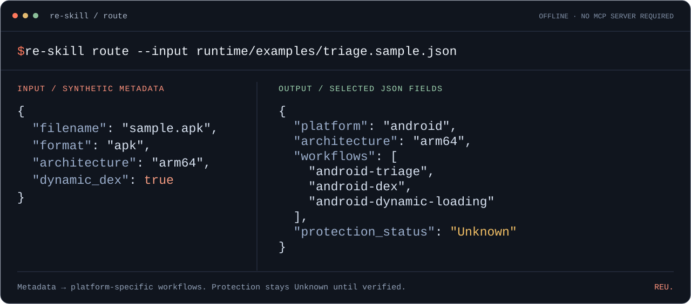

<div align="center">

<picture>
  <source media="(max-width: 600px) and (prefers-color-scheme: dark)" srcset="docs/assets/readme-hero-dark-mobile.svg">
  <source media="(max-width: 600px)" srcset="docs/assets/readme-hero-mobile.svg">
  <source media="(prefers-color-scheme: dark)" srcset="docs/assets/readme-hero-dark.svg">
  
</picture>

# Reverse Engineering & Unpacking

**Give your AI agent a method for reverse engineering—from triage to verified reconstruction.**

Windows / .NET · Android / DEX · Native / ELF

[](pyproject.toml)
[](CHANGELOG.md)
[](LICENSE)

[**See the results**](#measured-cases) · [**Quick start**](#quick-start) · [CI & downloads](https://github.com/rancy777/reu/actions/workflows/ci.yml?query=branch%3Amain) · [Docs](#documentation)

**English** · [简体中文](README.zh-CN.md) · [日本語](README.ja.md) · [한국어](README.ko.md) · [Español](README.es.md) · [Français](README.fr.md) · [Deutsch](README.de.md) · [Português (Brasil)](README.pt-BR.md) · [Русский](README.ru.md)

</div>

REU is an **agent Skill + Python CLI** for inspecting artifacts, planning experiments, connecting existing analysis tools, and preserving verifiable results. Bring your sample and analysis environment; REU supplies the investigation workflow, routing and records.

## Measured cases

**VMProtect 3.8.4 · Windows x64 · 2026-10-17**

<picture>
  <source media="(max-width: 600px) and (prefers-color-scheme: dark)" srcset="docs/assets/readme-cases-dark-mobile.svg">
  <source media="(max-width: 600px)" srcset="docs/assets/readme-cases-mobile.svg">
  <source media="(prefers-color-scheme: dark)" srcset="docs/assets/readme-cases-dark.svg">
  
</picture>

- **[Packing → standalone reconstruction](docs/cases/vmprotect-3.8.4-x64.md)**: runtime dumping and import repair produced an independently runnable EXE. [Source & acceptance](examples/vmprotect-3.8.4-x64).
- **[Function virtualization → native semantics](docs/cases/vmprotect-3.8.4-virtualized-x64.md)**: real debugger trace → recovered expression → compiled native function. [Source, recovered IR & acceptance](examples/vmprotect-3.8.4-virtualized-x64).

Two owned samples with different protection settings. Packing used a known OEP and manual import repairs. Function recovery covers one pure function with a separately rebuilt CLI harness; full-domain SMT equivalence remains unproved. Reports retain settings, failed attempts and scope.

[](docs/assets/vmp-3.8.4-virtualized-x64/07-recovered-native-function.jpg)

<p align="center"><sub>Actual DIE capture: the start of the recovered native DLL function. Click to inspect at full size. The complete 53-instruction listing and artifact hashes are in the <a href="docs/cases/vmprotect-3.8.4-virtualized-x64.md">case report</a>.</sub></p>

<details>
<summary>Packing: before protection → protected → reconstructed entry point</summary>

**Before protection — original entry point**


**Protected — protector entry point**


**Reconstructed — original entry point with rebuilt imports**


[PE headers, sections, imports, hashes and reconstruction limits](docs/cases/vmprotect-3.8.4-x64.md).

</details>

<details>
<summary>Function virtualization: original arithmetic → VM entry → recovered native instructions</summary>

**Before virtualization — SDK-marked arithmetic**


**Virtualized — function enters the VMP VM**


**Recovered — native instructions compiled from recovered semantics**


These are actual static disassembly captures. The recovered function preserves the tested behavior; it is not a byte-identical restoration of the original function or whole EXE. [Trace, validation and limits](docs/cases/vmprotect-3.8.4-virtualized-x64.md).

</details>

## Quick start

With **Python 3.11+** and access to this private repository, clone the source and run:

```bash
git clone https://github.com/rancy777/reu.git
cd reu
python -m pip install -e .
re-skill route --input runtime/examples/triage.sample.json
```

No MCP server or target execution is required. The included synthetic metadata declares dynamic DEX loading, so the runtime selects the corresponding workflows. `Unknown` remains explicit.

<details>
<summary>See the actual output and routing example</summary>

Selected fields from the JSON output:

```json
{
  "platform": "android",
  "architecture": "arm64",
  "workflows": [
    "android-triage",
    "android-dex",
    "android-dynamic-loading"
  ],
  "protection_status": "Unknown"
}
```

<picture>
  <source media="(max-width: 600px)" srcset="docs/assets/readme-demo-mobile.svg">
  
</picture>

</details>

Then try a file you are authorized to analyze:

```bash
re-skill triage --file ./sample.exe --route
```

Triage records the SHA-256, inspects supported file structures, and recommends a workflow **without executing the target**. APK, AAB, DEX, and ELF / SO files take their own routes.

### Use with your agent

Install the complete local Skill; the installer stops if an installation already exists:

```bash
python scripts/install_skill.py
```

Use it in a Skill-capable agent:

```text
$reverse-engineering-unpacking
Analyze ./sample.exe, which I am authorized to inspect.
Start with read-only triage: SHA-256, architecture and protection indicators.
Propose the next experiment, explain what it verifies, and keep the evidence.
Separate observed facts, hypotheses and unknowns.
```

The default copy lives at `~/.agents/skills/reverse-engineering-unpacking`. Install the CLI separately and give the agent its absolute executable path when working elsewhere. [Host discovery and isolated installation](docs/getting-started.md).

### Rebuild the native demo

Have **Windows x64, Python 3.11 x64, and Visual Studio C++ x64 build tools with a Windows SDK**? From the project root:

```powershell
powershell -NoProfile -File .\examples\vmprotect-3.8.4-virtualized-x64\source\rebuild_demo.ps1
```

This downloads pinned llvmlite into a fresh environment, compiles the published recovered IR, links the DLL and CLI harness, and runs **45 behavior checks** on a renamed EXE alone. No VMProtect or proprietary SDK is needed. Outputs go to `runtime-artifacts/vmp-native-demo`; an existing directory is refused. [Details and full experiment prerequisites](examples/vmprotect-3.8.4-virtualized-x64/README.md).

This rebuilds the recorded recovery result. It does not unpack a new target or rerun the protected-program comparisons.

## Why REU

- **Know what to inspect next.** Follow platform workflows with hypotheses, expected observations and failure diagnosis for each experiment.
- **Use the tools you have.** Discover actual MCP capabilities and plan calls against live input schemas.
- **Make success inspectable.** Keep hashes, traces, behavior checks and structural checks. Failed experiments remain useful evidence.

```text
Artifact → Triage → Hypothesis → Experiment → Validation → Reusable case
                                    ↑           │
                                    └─ Revise ──┘
```

## Research scope

| Target | Built-in triage and routing | Continue with |
| :--- | :--- | :--- |
| **Windows PE / .NET** | Headers, architecture, CLR indicators, sections, entropy signals | [Windows](workflows/windows-triage.md) · [.NET](workflows/windows-dotnet.md) |
| **Android APK / AAB** | Package structure, DEX / native-library inventory, split-aware routes | [Android](workflows/android-triage.md) · [Splits & AAB](workflows/android-split-aab.md) |
| **DEX / ART artifacts** | DEX, CDEX and VDEX identification; runtime-artifact routing | [DEX](workflows/android-dex.md) · [ART](workflows/android-art-runtime.md) |
| **Native ELF / SO** | ELF identity and architecture; Android routing with supplied context | [ELF](workflows/native-elf-triage.md) · [Android native](workflows/android-native.md) |

The guides cover unpacking, dynamic loading, and complex protection research. Successful reconstruction still requires external tools, target-specific experiments, and validation.

## Connect your tools

If your host already exposes MCP tools, use [host-native mode](runtime/host-integration.md). For a separate client bridge:

```bash
python -m pip install -e '.[mcp]'
```

Create `providers.json` from [the disabled template](runtime/config/providers.ready-to-install.json) and configure your installed server using [Provider Setup](integrations/PROVIDER-SETUP.md).

<details>
<summary>Configuration checks, discovery commands and tool candidates</summary>

```bash
re-skill doctor --config ./providers.json
re-skill discover --config ./providers.json --registry ./integrations/mcp-provider-registry.yaml --output discovery.json
```

`doctor` checks offline. `discover` starts enabled, registry-approved providers. The bridge supports stdio and Streamable HTTP with separate authorization gates for execution and mutation.

The [tool catalog](integrations/mcp-upstream-catalog.yaml) includes IDA, Ghidra, x64dbg, WinDbg, JADX, Frida and other candidates. Inclusion does not certify compatibility; tools and servers are installed separately. [Adapter planning](integrations/provider-adapter-profiles.json) · [Security review](integrations/SECURITY-REVIEW.md).

</details>

## Project status

**v1.5.0 · engineering candidate.** Two Windows native-tool experiments are recorded; broader sample coverage remains open. Third-party MCP providers follow their upstream installation instructions; repeating provider validation is not a release prerequisite. [Windows/Ubuntu CI](https://github.com/rancy777/reu/actions/workflows/ci.yml?query=branch%3Amain) checks Python 3.11–3.14, installation, source integrity and the native demo. Successful runs provide verified source archives, wheels and demo evidence under **Artifacts**. [Verification](docs/verification.md) · [Scope and remaining work](docs/project-status.md).

<details>
<summary>Run local checks and interpret corpus counts</summary>

```bash
python -m pip install -e '.[test]'
python -m pytest -q runtime/tests
re-skill regress --strict --file corpus/regression/automated.jsonl
```

The automated gate has 16 executable records. The separate research dataset retains 5 PARTIAL / 3 MANUAL; its strict mode intentionally exits with code 2. All 24 original records and assertions are preserved.

The [seed corpus](corpus/STATUS.md) has one public metadata entry, 14 mechanism-family cards and zero measured compatibility observations. These are inventory counts, not demonstrated case coverage. [Source archives and release checks](docs/releasing.md).

</details>

## FAQ

**Does one command unpack any VMP program?** No. The CLI performs triage, routing and evidence operations. Reconstruction uses external tools and target-specific research; the two measured cases are not a universal unpacker.

**What does the native demo reproduce?** Compilation of already recovered LLVM IR and 45 functional checks on its CLI harness. The original experiment's trace replay, 100,008 native input checks and 128 protected-program comparisons have separate evidence.

**Are tools, SDKs and protected executables included?** The source package contains scripts, recovered IR, text evidence and real screenshots. Native tools, proprietary SDKs, target binaries and memory dumps are excluded. Building a fresh protected sample requires your own VMProtect installation and SDK.

**Must I configure MCP first?** Offline CLI examples work immediately. A host with connected analysis tools can use its native inventory; standalone provider setup is documented in [Connect your tools](#connect-your-tools).

## Documentation

| Start here | Go deeper |
| :--- | :--- |
| [Getting Started](docs/getting-started.md) | [Architecture](docs/architecture.md) · [Runtime](runtime/README.md) |
| [Agent Skill](SKILL.md) | [Host Integration](runtime/host-integration.md) · [Provider Setup](integrations/PROVIDER-SETUP.md) |
| [Evidence Policy](references/evidence-policy.md) | [Evidence Card](templates/evidence-card.md) · [Case Report](templates/case-report.md) |
| [Research Sources](references/source-registry.md) | [MCP Sources](references/mcp-source-registry.md) · [Corpus Status](corpus/STATUS.md) |
| [README translations](docs/translations.md) | Available languages, translation scope and maintenance |

## Contributing

Help make the next investigation better: contribute a **reproducible case**, a **versioned provider experiment**, a **regression fixture**, or a **documented failure**. Include the environment, expected observation, actual outcome, and evidence.

Read [Contributing](CONTRIBUTING.md) to get started. Current priorities are real Windows / Android fixtures, independent case reproduction, and a larger versioned case corpus.

## Responsible use & license

For owned software, authorized assessments, isolated malware analysis, CTFs, interoperability, education, and defensive research. Run untrusted samples in an isolated environment. The runtime is not a sandbox; see [Security](SECURITY.md) for the execution and storage model.

[MIT](LICENSE) · Upstream tools and providers retain their own licenses.
