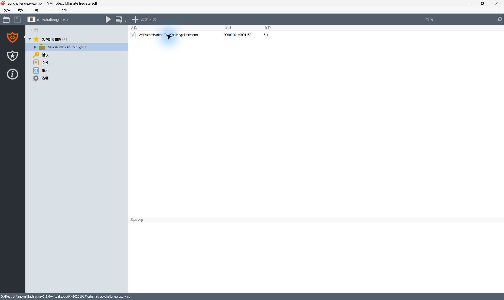
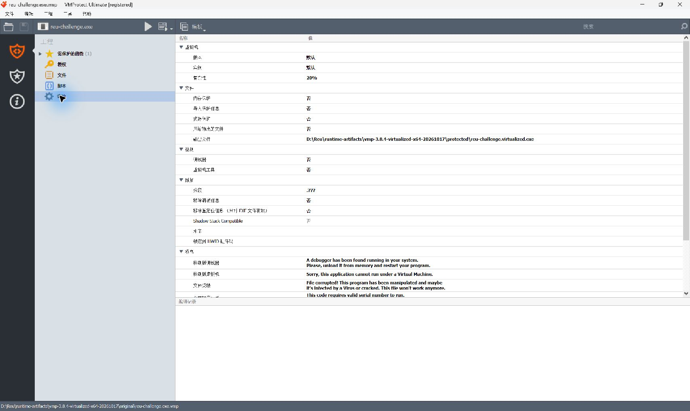
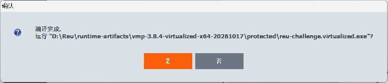
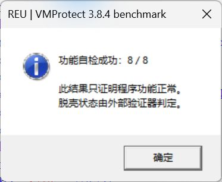

# VMProtect 3.8.4：一个虚拟化纯函数的语义重建

**真实虚拟化标记 → 21,849 条原生调试轨迹 → Triton 符号表达式 → 53 条独立 x64 指令。**

日期：**2026-10-17**。目标是自建的七轮 `uint32_t` 计算函数。本次确认它确实经过 VMProtect 函数虚拟化，并从受保护程序的真实执行轨迹恢复出可独立执行的函数语义。

| 验证项 | 实测结果 |
| --- | --- |
| 恢复函数的输入检查 | **100,008 / 100,008 PASS**，边界值与固定随机种子 |
| 与 VMP 程序的输入/输出差分 | **128 / 128 PASS** |
| 原生函数实现 | **53 条 x64 指令**，无调用、无跳转调度；以 `ret` 返回 |
| 独立函数 DLL | **2,048 字节**；无导入项、无 VMP 运行时依赖 |
| CLI 演示程序 | **4,608 字节**；单独复制、改名后 **45 / 45 PASS** |
| 篡改验证 | 修改恢复函数的一字节 XOR 常量后，验证器在 `python -O` 下正确拒绝 |
| 源码复建 | 从随附源文件与恢复 IR 重新构建，DLL 和 EXE 均逐字节相同 |
| 全域 SMT 证明 | **未通过：120 秒超时，结果 unknown**；不宣称全部 2³² 输入已获证明 |

[验收原始数据](../../examples/vmprotect-3.8.4-virtualized-x64/evidence/acceptance.json) · [源代码与复现命令](../../examples/vmprotect-3.8.4-virtualized-x64/README.md) · [样本和轨迹 SHA-256](../../examples/vmprotect-3.8.4-virtualized-x64/evidence/case-record.json)

## 结论边界

这是**单个已知纯函数的语义重建**。恢复过程读取受保护 PE、真实指令轨迹和寄存器/栈状态，**不读取原始 C++ 算法或原始 EXE**。原算法只用于独立验证。

演示 EXE 的参数处理、打印和测试外壳是重新编译的；其核心计算链接自恢复 IR 生成的对象文件。**这不是整个受保护 EXE 的原样还原，也不是通用 VMP 去虚拟化工具。** 输入相关分支、外部内存副作用、Ultra 模式、其他版本与真实 MCP Provider 均不在本次验证范围内。

这次将打包、内存/导入/资源保护、调试器检测和虚拟机检测都关闭，保留默认 VM 版本/实例和 **20% VM complexity**，单独测函数虚拟化。它与[此前默认加壳案例](vmprotect-3.8.4-x64.md)是不同配置、不同样本，不能混合统计。

## 1. 用 SDK 明确标记核心计算

[目标源文件](../../examples/vmprotect-3.8.4-virtualized-x64/source/challenge.cpp)使用用户提供的 SDK：

```cpp
uint32_t ReuChallengeTransform(uint32_t x) {
    VMProtectBeginVirtualization("ReuChallengeTransform");
    // 七轮 uint32 计算；完整实现见源文件。
    VMProtectEnd();
    return x;
}
```

工具为 **VMProtect Ultimate 3.8.4.1754**。VMP 界面识别到一个名为 `ReuChallengeTransform` 的标记，保护类型为 **虚拟化**，标记地址为 VA `0x14000115F`。原函数导出入口 RVA 为 `0x1150`。MSVC 在标记区域内将七轮循环展开为直线代码。





原程序需要旁边的 `VMProtectSDK64.dll` 才能运行。受保护程序和恢复后的产物均不需要它。专有 SDK 文件没有放入源码分发包。

## 2. 确认保护生效

界面编译完成后，受保护 EXE 为 **2,327,552 字节**，通过 45 项功能检查。[受保护文件 PE 概览截图](../assets/vmp-3.8.4-virtualized-x64/04-virtualized-pe-overview.jpg)。与前一个开启压缩的案例不同，这次 PE 入口点仍为 `0x1200`；需要观察的是被标记的函数，而非只看整个 EXE 的入口。



**原始函数**：SDK 标记调用后，是可读的 XOR、旋转、乘法与减法指令。


**虚拟化后**：原位置转入保护器入口。其后线性反汇编中的 `db`、异常指令不能直接当作真实执行路径；实际路径由下一步的调试轨迹确认。


DIE 的签名识别结果本身不是函数虚拟化的充分证据；这里同时保留了 SDK 标记、编译配置、原位置代码变化和真实执行轨迹。

## 3. 采集真实执行，恢复输入/输出关系

使用 x64dbg **2026.05.27** 中的 `headless.exe`。图形前端仍有此前记录的 Qt 插件冲突；没有伪造图形调试器截图。

在 `--value 42` 的调用中，调试器于函数入口暂停，记录从 RVA `0x1150` 到调用方返回 RVA `0x142F` 的执行。采集得到 **21,850 行原生状态**，其中包含返回后的状态；实际重放 **21,849 条指令**。原生返回值为 `0xA7574EAC`，即 **2807516844**。

[完整规范化轨迹](../../examples/vmprotect-3.8.4-virtualized-x64/evidence/native-function.trace.txt)保留每条指令的地址、字节、17 个寄存器/标志字段和栈顶字节。原始采集有两个不支持的内存格式字段；规范化时仅删除这两个字段，[保留字段未修改](../../examples/vmprotect-3.8.4-virtualized-x64/evidence/trace-normalization.json)。

[Triton 重放脚本](../../examples/vmprotect-3.8.4-virtualized-x64/source/replay_native.py)将 Windows x64 的 `ECX` 输入符号化，保留输入对输出的影响，并同步轨迹中的具体状态。它拒绝符号状态不一致与控制流不一致。此次严格重放完成，没有记录到符号路径约束；这不能作为任意程序的路径覆盖保证。

最初直接离线模拟 PE 的尝试在 VM 调度中偏离，未被计为成功。接受的是与真实执行逐步对应的轨迹重放。方法参考 [Triton 官方项目](https://github.com/JonathanSalwan/Triton)与 [Jonathan Salwan 的纯函数实验](https://github.com/JonathanSalwan/VMProtect-devirtualization)，并针对本样本的 Windows ABI 实现了重放与验证。

## 4. 编译恢复出的原生函数

重放产生[恢复 IR](../../examples/vmprotect-3.8.4-virtualized-x64/recovered/recovered.ll)，再经 **LLVM 22.1.0 / llvmlite 0.50.0** 优化和原生编译。编译器只读取恢复 IR；不会把原始算法源码重新编译后冒充恢复结果。

[生成的原生汇编](../../examples/vmprotect-3.8.4-virtualized-x64/recovered/recovered.asm)与[最终 DLL 反汇编](../../examples/vmprotect-3.8.4-virtualized-x64/evidence/recovered-function-disassembly.txt)共 **53 条指令**。独立 DLL 只有 `.text`、`.rdata` 两个节，无导入项，函数无需 VM 解释器、调度跳转或外部调用。


[CLI 外壳源码](../../examples/vmprotect-3.8.4-virtualized-x64/source/recovered_harness.cpp)单独处理输入输出，并调用恢复函数。它不包含核心算法实现。这一区分保留了函数恢复与整程序重建之间的边界。

## 5. 独立验收，而非固定打印成功

[验收器](../../examples/vmprotect-3.8.4-virtualized-x64/source/verify_recovery.py)实际加载 DLL，计算并检查 100,008 项输入，再运行受保护程序完成 128 项差分，并检查 PE 结构和原生控制流。随后将演示 EXE 单独复制、改名，执行 45 项 CLI 检查。全部通过才输出：

```text
函数语义重建验证成功（仅当前自有纯函数样本）
```

EXE 自己显示的 `8/8` 只是功能自检；原程序和 VMP 程序都能通过。它不是去虚拟化状态检测器。



为检查验收器是否真的会失败，临时副本中的一字节 XOR 常量被修改。验收器在 **`python -O`** 下仍以退出码 1 拒绝该副本，首个输入 0 就不匹配。正式产物未修改。[负向验证记录](../../examples/vmprotect-3.8.4-virtualized-x64/evidence/negative-verifier.json)。

此外，在另一临时目录从随附 IR 和源文件重建 DLL 与 EXE，两个文件均逐字节相同。[复建记录](../../examples/vmprotect-3.8.4-virtualized-x64/evidence/source-rebuild-check.json)。

全域 Z3 等价证明在 120 秒后返回 `unknown`，因此这里报告的是抽样行为验证与结构验证，不能改写成“全部 2³² 输入已证明”。[超时记录](../../examples/vmprotect-3.8.4-virtualized-x64/evidence/expression-proof.json)。

## 产物身份

| 产物 | SHA-256 |
| --- | --- |
| 原始 SDK 标记程序 | `b3788d54a7b08ec1680204a93c5cff08c2c0fc24f828fbdce45b385ce00b916e` |
| 接受的虚拟化程序 | `54dc992a7682fc62e15c595f44b2d58a247fc75a60d454412c50222f75c28270` |
| 独立恢复函数 DLL | `a0dd796575fdb360bef477f2a3c5c3eea2d2ae8aa1313ee71075067d04053c86` |
| 原生函数演示 EXE | `fb3ab1087a61be783e4f4055828908acbdeb08413500b348a534dcb174b3d616` |

截图来自实际原生窗口，未合成工具输出。调试与恢复的文本证据单独提供，可按哈希核对。专有工具、SDK、目标二进制、进程快照不包含在源码分发包内。

本地目录为 `D:\Reu`，实验位于 `runtime-artifacts/vmp-3.8.4-virtualized-x64-20261017`。当前没有 Git 仓库、分支、HEAD 或可核验的远程基线；没有 commit、push、合并、部署或发布 GitHub Release。
