# VMProtect 3.8.4: one owned x64 reconstruction

**12.03 MiB packed image → 5 KiB standalone EXE. 45/45 behavior checks. 14/14 structure checks.**

Recorded **2026-10-17** on Windows, using a C++ program built specifically for this experiment. The final file was renamed and run alone in an empty temporary directory; all 45 behavior checks passed there as well.

> 中文摘要：本自有样本的默认加壳与导入保护已完成重建验证。使用了已知原入口点，并人工修复 9 处导入调用；没有选择函数虚拟化，因此不能据此宣称通用 VMP 脱壳或去虚拟化。

A separate follow-up now validates [one SDK-marked virtualized pure function](vmprotect-3.8.4-virtualized-x64.md). Its results belong to that distinct experiment.

## Result and scope

| Artifact | Bytes | Result |
| --- | ---: | --- |
| Original C++ EXE | 4,608 | 45/45 behavior checks |
| VMProtect-protected EXE | 12,616,192 | DIE: `VMProtect [packed]`; 45/45 behavior checks |
| Scylla runtime dump | 20,044,288 | Intermediate memory image; not accepted as a standalone reconstruction |
| Final reconstructed EXE | **5,120** | **45/45 behavior + 14/14 structure checks** |

The VMP project enabled compression, memory protection, import protection and resource protection. Debugger detection and VM-tool detection were off. **The protected-functions list was empty.** The [recorded project XML](../../examples/vmprotect-3.8.4-x64/evidence/vmp-project.xml) and [machine-readable case record](../../examples/vmprotect-3.8.4-x64/evidence/case-record.json) preserve those settings and artifact hashes.

This is **benchmark-assisted, case-specific reconstruction**. The original OEP RVA and original section ranges were known from the reference build. Nine import-call sites were identified manually; the reconstruction script does not discover these in arbitrary software. No virtualized function, third-party MCP provider, Android target, or other VMP version was validated.

The original EXE was used as a build/behavior reference. **Its code and data were not inputs to the reconstruction script**: retained sections came from the protected process's runtime dump. REU's native-tool investigation workflow was used; this was not an end-to-end run through a reviewed x64dbg MCP provider.

## Inside the three files / 三阶段内部对照

These additional captures were taken on **2026-10-17** by reopening the exact three hashed artifacts in **DIE 3.21**, in read-only mode. They are unedited native window captures of the saved files. They show static structure and disassembly, not a debugger stopped in the earlier live session. [Capture hashes and per-descriptor PE metadata](../../examples/vmprotect-3.8.4-x64/evidence/internal-comparison.json) identify their inputs.

| Detail | Before protection / 加壳前 | Protected / 加壳后 | Reconstructed / 脱壳后 |
| --- | --- | --- | --- |
| File size | 4,608 bytes | 12,616,192 bytes | 5,120 bytes |
| Entry-point RVA | `0x11F0` | `0x7B51B1` | `0x11F0` |
| Image size | `0x4000` | `0x1323000` | `0x5000` |
| Sections | 3 | 7 | 4, including rebuilt `.idata` |
| PE overview | [Original](../assets/vmp-3.8.4-x64/09-original-overview.jpg) | [Protected](../assets/vmp-3.8.4-x64/10-protected-overview.jpg) | [Reconstructed](../assets/vmp-3.8.4-x64/11-unpacked-overview.jpg) |
| Sections and bytes | [Original](../assets/vmp-3.8.4-x64/12-original-sections.jpg) | [Protected](../assets/vmp-3.8.4-x64/13-protected-sections.jpg) | [Reconstructed](../assets/vmp-3.8.4-x64/14-unpacked-sections.jpg) |
| Import table | [Original](../assets/vmp-3.8.4-x64/15-original-imports.jpg) | [Protected](../assets/vmp-3.8.4-x64/16-protected-imports.jpg) | [Reconstructed](../assets/vmp-3.8.4-x64/17-unpacked-imports.jpg) |
| Entry-point disassembly | [Original](../assets/vmp-3.8.4-x64/18-original-entrypoint.jpg) | [Protected](../assets/vmp-3.8.4-x64/19-protected-entrypoint.jpg) | [Reconstructed](../assets/vmp-3.8.4-x64/20-unpacked-entrypoint.jpg) |

The original and reconstructed entry points begin with the same `push rbx; push r14; sub rsp, 0x68` sequence. At RVA `0x11F8`, the indirect call changes from the original IAT slot at VA `0x140002000` to the rebuilt slot at `0x1400040E0`. The protected file instead enters the protector at VA `0x1407B51B1`. Its linear static disassembly includes `db` and implausible instructions; this view does not establish the actual executed control flow or demonstrate devirtualization.

The protected section table shows zero raw sizes for the original `.text`, `.rdata` and `.pdata`, plus protector sections `.@*1`, `.=9-`, `.cYj` and `.reloc`. The reconstructed table shows the three retained sections plus `.idata`. The import screenshots show the currently selected descriptor's functions; `USER32!MessageBoxW` is in the other descriptor. Reordering imports and changing IAT addresses are expected consequences of rebuilding, so the reconstructed file is not byte-identical to the original.

<details>
<summary>入口点反汇编：加壳前 → 加壳后 → 脱壳后</summary>

**加壳前：原始入口点**


**加壳后：保护器入口点**


**脱壳后：恢复原入口点，调用重建的 IAT**


</details>

<details>
<summary>节区与原始字节：3 个节 → 7 个节 → 4 个节</summary>

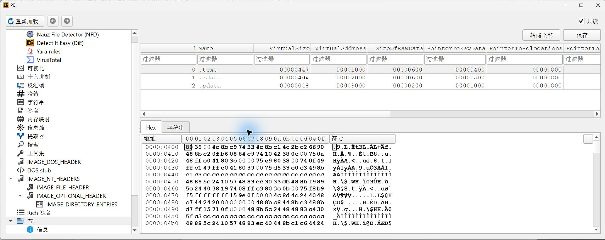

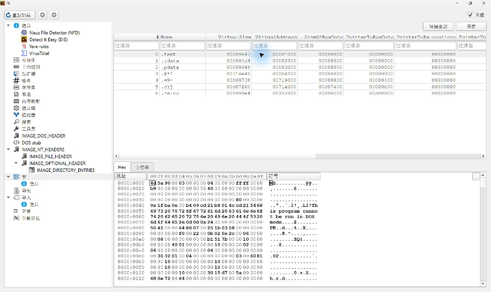

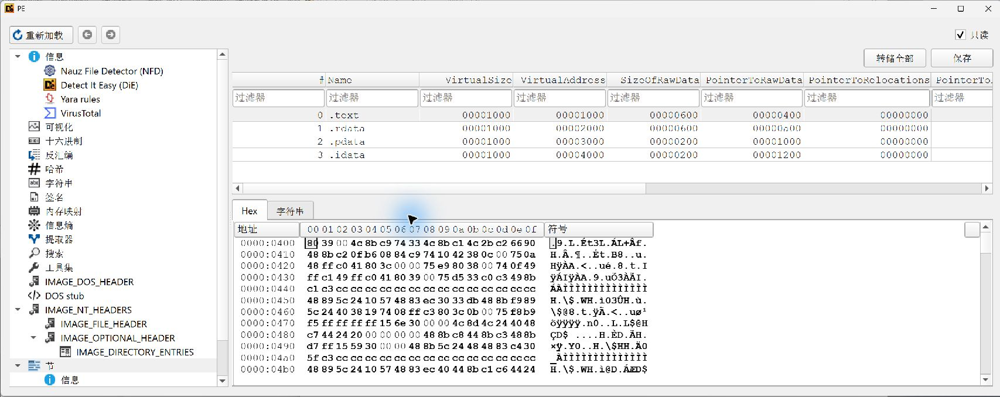

</details>

<details>
<summary>导入表：原始布局 → 保护后的布局 → 重建布局</summary>

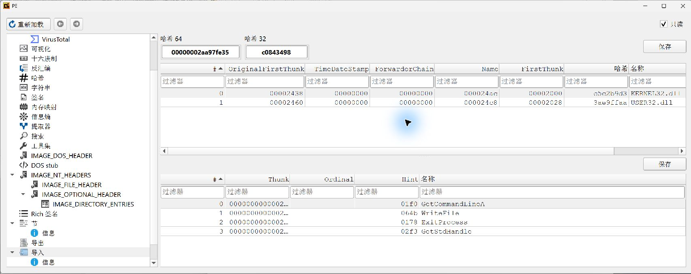

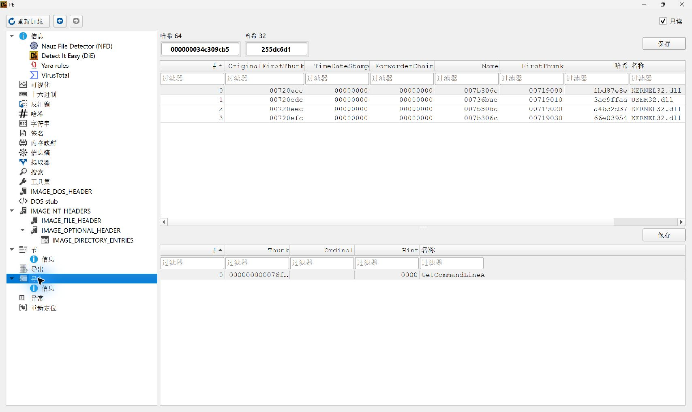

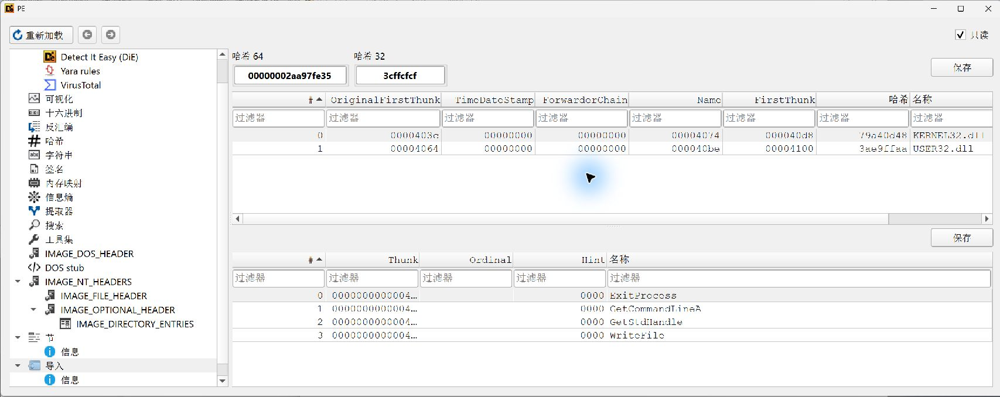

</details>

## 1. Build an observable target

The [C++ source](../../examples/vmprotect-3.8.4-x64/source/challenge.cpp) implements a deterministic 32-bit transform. It supports arbitrary numeric inputs, eight embedded self-test vectors, a deliberate negative path, invalid-input exits, and a `--show` dialog. The [external oracle](../../examples/vmprotect-3.8.4-x64/source/validate_behavior.py) calculates expected values independently.

The compiler was **MSVC 19.44.35215**, with Windows SDK **10.0.22621.0**. The x64 build uses no CRT, preserves ASLR/NX linker flags, and uses `/Brepro`. A second build from the published source directory produced the **same original SHA-256**. [Build and reproduction instructions](../../examples/vmprotect-3.8.4-x64/README.md) accompany the source.

The target reports **functional self-test success**, not a self-declared unpacking verdict. Both the original and packed program can pass that test. Acceptance requires the external behavior and structural checks below.

## 2. Record the actual protection

The screenshots below are native window captures from the actual experiment, without compositing or generated tool output.

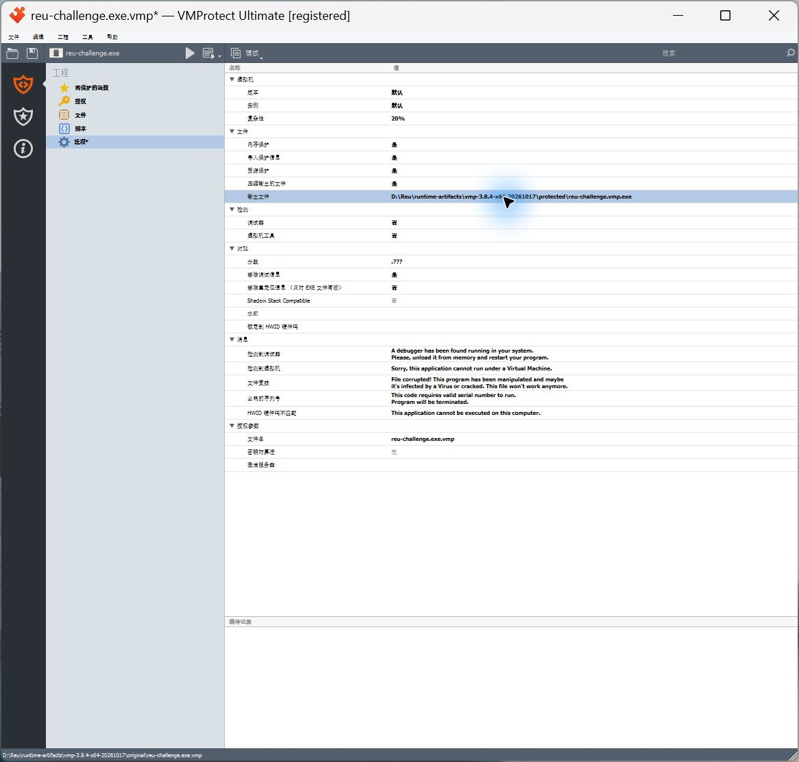

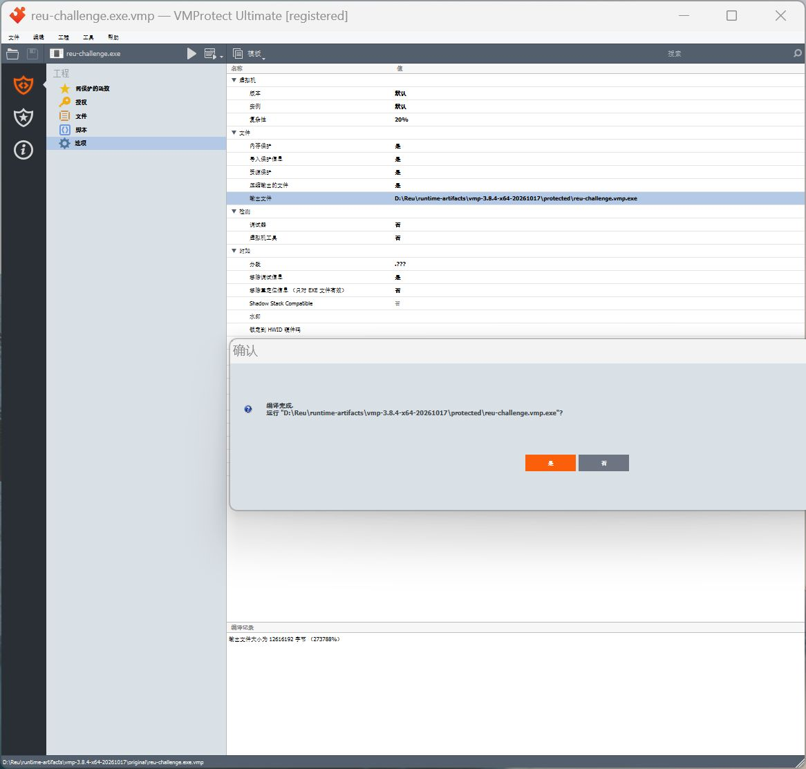

The exact version **3.8.4** came from VMProtect's welcome screen and its product-version resource (**file version 3.8.4.1754**); DIE's signature identifies the family and packed state, not that precise version.

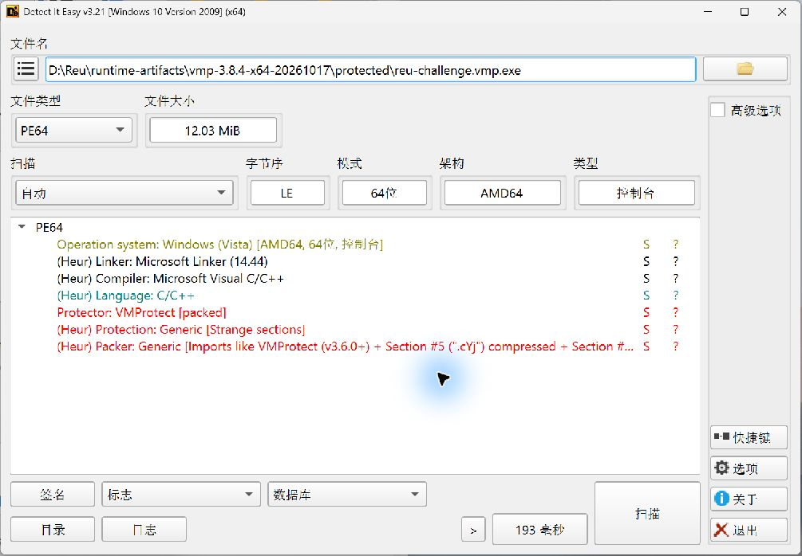

## 3. Reach the original code and dump memory

x64dbg's graphical frontend encountered a host Qt plugin conflict: it loaded a system Qt 5.15 platform plugin while the package contained Qt 5.12. The bundled **`headless.exe` from release 2026.05.27** worked. The experiment used that real debugger backend, not a simulated debugger screen.

For this benchmark, the known original OEP was RVA **`0x11f0`**. A hardware execute breakpoint eventually stopped the protected process there. The packed entry point was RVA `0x7b51b1`; these are different execution stages.

Selected commands, entered only after the preceding debugger state had completed:

```text
init "<protected EXE>", "--self-test"
bph mod.main()+11F0,x,1
run
run
```

The two `run` steps move through the packed entry point and into the restored original entry point. The [selected raw trace](../../examples/vmprotect-3.8.4-x64/evidence/api-trace.txt) records the actual stop and API observations:

```text
REU OEP HIT: pid=34076, base=00007FF7D43F0000, cip=00007FF7D43F11F0, size=0000000001323000
```

**Scylla x64 v0.9.8** exported the runtime image through its official `ScyllaDumpProcessW` API. Normal and advanced `ScyllaIatSearch` both returned **`-4` (IAT not found)**. The raw dump was retained as an intermediate artifact. The Scylla GUI was opened for inspection; this screenshot does not imply that its automatic import reconstruction succeeded.

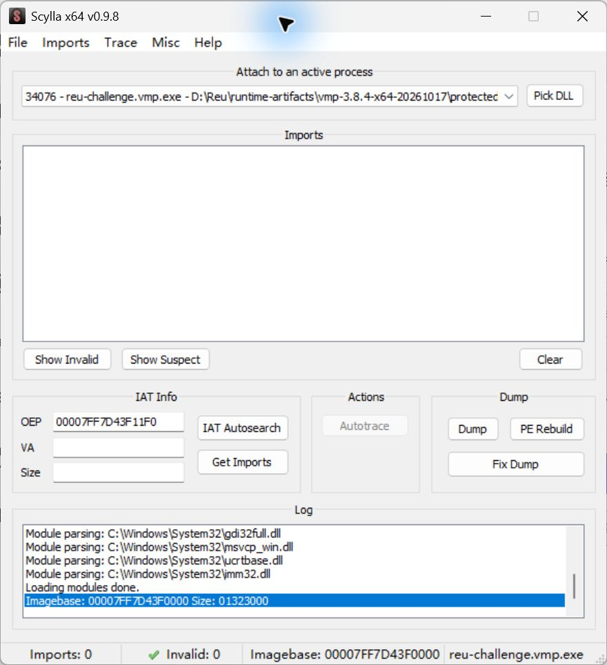

## 4. Repair this sample's imports

The dumped code contained nine protector-generated import-call replacements. Four normal self-test call-site relationships were corroborated directly in the API trace. The remaining numeric/failure/GUI paths were identified from disassembly and arguments, then checked through execution. The [case-specific script](../../examples/vmprotect-3.8.4-x64/source/rebuild_case.py) makes every assumption explicit.

| API | Repaired call-site RVAs |
| --- | --- |
| `KERNEL32!GetCommandLineA` | `0x11f8` |
| `KERNEL32!GetStdHandle` | `0x1074`, `0x1120` |
| `KERNEL32!WriteFile` | `0x1091`, `0x113d` |
| `KERNEL32!ExitProcess` | `0x13a7`, `0x1434`, `0x1440` |
| `USER32!MessageBoxW` | `0x1399` |

LIEF **1.0.0** rebuilt the import table. The nine sites became ordinary RIP-relative IAT calls. Scylla's official PE rebuild API normalized the file layout; the final header also records the rebuilt IAT range. Retained sections are `.text`, `.rdata`, `.pdata`, and the new `.idata`. The protector's sections and loader references are absent.

Structural validation caught an oversized virtual gap after section removal and an initially empty IAT-directory entry. Those were corrected before accepting the final artifact. Earlier candidates remain in the local history; the hashes below identify the accepted file.

## 5. Verify independently

**45 behavior checks** cover the eight-vector self-test, the deliberate failure path, 40 numeric inputs including boundaries and deterministic random inputs, and three invalid-input cases. The accepted EXE was also tested as the only file in an empty temporary working directory, under a different filename.

**14 structural checks** verify x64 format, the four expected sections, the original entry point, the compact image/file layout, no TLS-loader callback, no relocation reference to removed sections, NX, checksum, an IAT range covering all import slots, the five intended OS imports, and no remaining external call into protector code. Code/data comparison uses the **runtime dump**: `.text` differs only at the nine documented repairs; retained read-only and unwind data match the dump.

The [acceptance command](../../examples/vmprotect-3.8.4-x64/source/verify_case.py) reruns both gates and verifies matching artifact hashes before printing `脱壳验证成功（仅当前自有样本；不代表去虚拟化）`. It reports failure and exits nonzero if a gate fails. This verdict comes from fresh verification, not a fixed string in the target program.

The final DIE GUI scan no longer reported VMProtect or the empty-IAT heuristic. The CLI scan reported `Unknown`, which is **not** by itself proof of successful unpacking. The behavior/structure evidence supplies the acceptance decision.

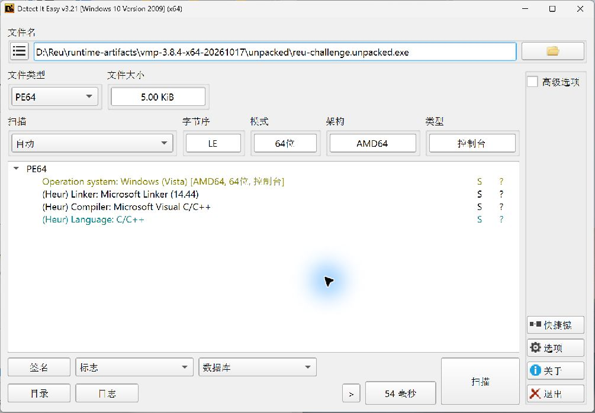

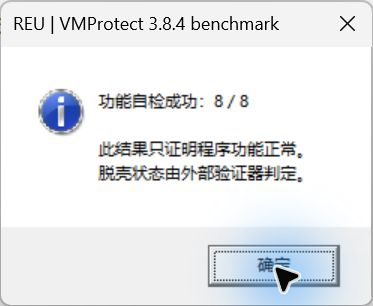

## Artifact identities

```text
Original SHA-256
e9ee846be5acede1ef04cf04800eff1fd54a5bf99f855045a149138b1e98fdfd

Protected SHA-256
0a53387dd751b73366c5153fdcc7b094aa7db7c4d5f0ccfab300c61b142f4178

Accepted reconstruction SHA-256
e667de6fbb997d8f957f8da2c322e14cb742faa256d463468f06a60d79be13a0
```

[Full identities, settings and checks](../../examples/vmprotect-3.8.4-x64/evidence/case-record.json) · [Source and reproduction notes](../../examples/vmprotect-3.8.4-x64/README.md)

Local source: `D:\Reu`; experiment: `D:\Reu\runtime-artifacts\vmp-3.8.4-x64-20261017`. There is no `.git` directory, branch, commit SHA or verified remote baseline. These are local, uncommitted experiment results; no commit, push, merge, deployment or GitHub release was performed. Proprietary tools and target/dump binaries are excluded from the source distribution.
